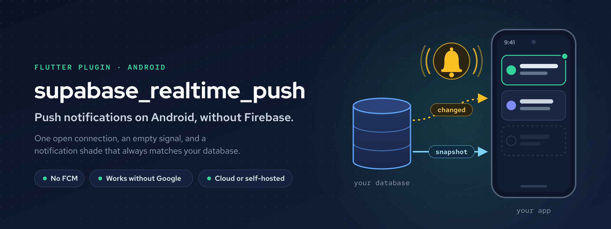
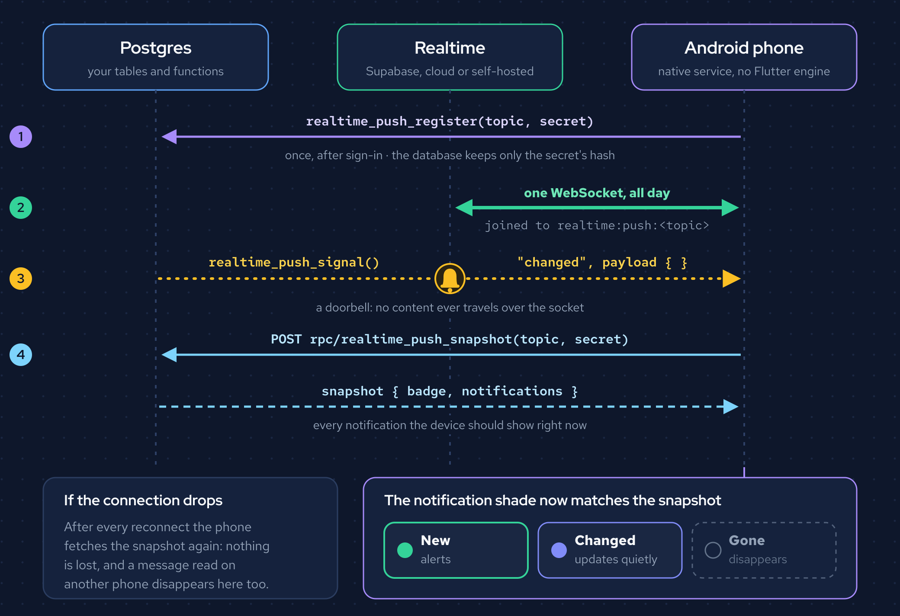

<h1 align="center">
  
</h1>

<p align="center">
  <a href="https://pub.dev/packages/supabase_realtime_push"></a>
  <a href="https://github.com/Franklyn-R-Silva/supabase_realtime_push/actions/workflows/ci.yaml"></a>
  <a href="https://github.com/Franklyn-R-Silva/supabase_realtime_push/actions/workflows/codeql.yml"></a>
  <a href="https://scorecard.dev/viewer/?uri=github.com/Franklyn-R-Silva/supabase_realtime_push"></a>
  <a href="https://www.bestpractices.dev/projects/17222"></a>
  <a href="LICENSE"></a>
  
  <a href="https://supabase.com/docs/guides/realtime"></a>
  <a href="https://flutter.dev"></a>
</p>

<p align="center">
  <strong>Push notifications on Android without Firebase.</strong><br />
  One Supabase Realtime connection, an empty signal, and a notification shade
  that always matches your database.
</p>

<p align="center">
  <a href="#setup"></a>
  <br />
  Works with Supabase Cloud and with self-hosted Supabase.<br />
  No FCM project and no <code>google-services.json</code>.
</p>

> **Status: first release; the API may still change before 1.0.** The design
> is in [doc/contract.md](doc/contract.md).

---

## What it does

A push notification is the message that pops up on a phone, like "Your order
has shipped", even when the app is closed. On Android, apps almost always get
them through Firebase, a Google service that needs Google's apps on the phone.

This library does the same job without Google. It is for Android apps made
with Flutter (a toolkit for building apps) that use Supabase (a ready-made
database and server). A small helper on the phone keeps one connection open
to the server, without starting the whole app. It works like a doorbell: when
something changes, the server only rings the bell. The phone then asks "what
should I show now?" and makes its notification list match the answer. With the
screen on that takes a second or two; with the screen off the phone mostly
sleeps, so a notification can take up to about five minutes, or about fifteen
when the phone has been still for a long time. If the
connection drops, in an elevator or on weak Wi-Fi, the phone asks again once
it is back, so nothing is lost. A message read on another phone disappears
from this one.

## Who it is for

It is for company phones without Google, fleets that install the app from a
file instead of the Play Store, and teams that run their own Supabase server.
It is not for iPhones, which do not let an app keep a connection open in the
background. If your app is on the Play Store and every user has Google, use
Firebase: it shares one connection among all the apps on a phone. The cost is
real: each phone holds a connection to your server while its screen is on.
Android also shows a small "connected" notification unless the app is exempt
from battery optimization. Ask for the exemption once when the user turns
notifications on (one tap, or none on a managed fleet) and it goes away. If
you cannot ask, `start(foregroundService: false)` never shows it, and
notifications then arrive more slowly with the app closed (see
[Battery](#battery-and-the-connected-notification)).

## Contents

- [How it works](#how-it-works)
- [Platform support](#platform-support)
- [Setup](#setup): [database](#1-database) ·
  [Flutter](#2-flutter) ·
  [register and start](#3-register-and-start-after-sign-in) ·
  [sign out](#4-sign-out) · [send](#5-send-a-notification) ·
  [taps](#6-handle-taps)
- [Your own data instead of the inbox](#your-own-data-instead-of-the-inbox)
- [Reply from the notification](#reply-from-the-notification)
- [Channels and pictures](#channels-and-pictures)
- [Battery and the "connected" notification](#battery-and-the-connected-notification)
- [Security](#security)
- [Limits](#limits)
- [Feedback and contributing](#feedback-and-contributing)

---

## How it works

<p align="center">
  
</p>

1. The app registers the device with your project: a random topic and secret,
   one pair per device. The database keeps only the secret's hash.
2. A native Android service keeps one WebSocket to Realtime, listening on that
   device's topic. It runs without the Flutter engine, so it uses a few MB of
   memory.
3. When something changes, the database sends an empty `changed` signal to the
   topic. No content ever travels over the socket.
4. The service asks a SQL function for the **snapshot** (every notification
   the device should show right now) and makes the shade match it: new ones
   alert, changed ones update quietly, gone ones disappear.

## Platform support

| Android | iOS | Web | Desktop |
|---|---|---|---|
| ✅ 7.0+ | ❌ iOS does not allow a background socket; use APNs | ❌ | ❌ |

On other platforms every call is a no-op, except `device()`, which throws, so
you can keep one code path and check `SupabaseRealtimePush.isSupported`.

---

## Setup

### 1. Database

Run [`supabase/realtime_push.sql`](supabase/realtime_push.sql) as a migration.
It is idempotent and creates, in `public`:

| Object | Called by | Does |
|---|---|---|
| `realtime_push_register(p_topic, p_secret, p_platform)` | the app, signed in | Links this device to `auth.uid()` |
| `realtime_push_unregister(p_topic)` | the app, signed in | Unlinks it (on sign-out) |
| `realtime_push_snapshot(p_topic, p_secret)` | the service (`anon`) | Returns the snapshot, or `null` for an unknown device |
| `realtime_push_send(p_user, p_key, p_title, p_body, p_data, p_silent)` | your backend (`service_role`) | Puts a notification in the user's inbox, signals their devices, returns the row id |
| `realtime_push_mark_read(p_key)` | the app, signed in | Clears that notification on every device |
| `realtime_push_snapshot_for(p_user)` | the snapshot | **Yours to replace** (see below) |
| `realtime_push_signal(p_users)` | your triggers | Wakes those users' devices |
| `realtime_push_reply(p_topic, p_secret, p_id, p_text)` | the service (`anon`) | Takes a reply typed in the notification |
| `realtime_push_reply_for(p_user, p_id, p_text)` | the reply | **Yours to replace** ([reply](#reply-from-the-notification)) |

#### Self-hosted Supabase: raise the Realtime connection limit first

Every device keeps one Realtime connection open while its screen is on (with
the screen off the processor sleeps and the connection drops within a minute;
the service reconnects when the screen turns on), and an open app's own
Supabase client holds another. So the peak is the phones whose screen is on,
or whose processor another app keeps awake (music, navigation), at the same
time, not every phone: size the limit for your busiest hour, with room to
spare. Self-hosted Realtime accepts **200** concurrent
connections per tenant by default and refuses the rest with `429 Too many
connected users`. Refused phones silently stop getting notifications.

```yaml
# docker-compose, realtime service
environment:
  TENANT_MAX_CONCURRENT_USERS: "2000"
```

With `SEED_SELF_HOST=true` the tenant is recreated from that variable on every
boot, so set it in the environment, not in the database. On Supabase Cloud the
limit is your plan's Realtime quota.

`TENANT_MAX_JOINS_PER_SECOND` (100 by default) matters after a Realtime
restart, when every device rejoins. The service spreads its retries randomly,
so a fleet of a few thousand catches up within a minute; raise it if yours is
bigger. `TENANT_MAX_EVENTS_PER_SECOND` (also 100) counts every signal: an
announcement to the whole fleet at once goes past it and Realtime drops
broadcasts for a while, so raise it or spread such sends out.

### 2. Flutter

```yaml
dependencies:
  supabase_realtime_push: ^0.0.1
```

The plugin's manifest brings its permissions, service and receivers. One
permission it leaves to you on purpose: add
`<uses-permission android:name="android.permission.REQUEST_IGNORE_BATTERY_OPTIMIZATIONS" />`
to your manifest only if you want the one-tap battery-exemption dialog and
Google Play's policy allows it for your app (see
[Battery](#battery-and-the-connected-notification)). Without it,
`requestIgnoreBatteryOptimizations()` opens the system list instead.

### 3. Register and start (after sign-in)

```dart
final supabase = Supabase.instance.client;

await SupabaseRealtimePush.requestNotificationPermission();
// No "connected" notification once granted; see Battery below.
if (!await SupabaseRealtimePush.isIgnoringBatteryOptimizations()) {
  await SupabaseRealtimePush.requestIgnoreBatteryOptimizations();
}
final device = await SupabaseRealtimePush.device();
await supabase.rpc('realtime_push_register', params: device.registerParams);
await SupabaseRealtimePush.start(
  supabaseUrl: Uri.parse('https://<ref>.supabase.co'),
  publishableKey: '<publishable or anon key>',
  channelName: 'Messages',
);
```

Call `start` while the app is on screen: Android 12+ refuses to start a
foreground service from the background. The service then survives the app
being closed, the phone rebooting and the app updating.

Run `device`, `realtime_push_register` and `start` again on every app start
while a session exists and `status()` is not `running`. A reinstall or a new
phone restores the app's settings from a backup but never the device pair, so
that install reports `stopped` until it registers its own; a `rejected` device
needs the same.

### 4. Sign out

```dart
final device = await SupabaseRealtimePush.device();
try {
  await supabase.rpc('realtime_push_unregister', params: device.unregisterParams);
} catch (_) {
  // Offline: sign out anyway. The forgotten pair can no longer read anything.
}
await SupabaseRealtimePush.stop(forgetDevice: true);
await supabase.auth.signOut();
```

`forgetDevice` deletes the pair, so the next person to sign in on this phone
gets a new one. Unregistering is best effort: without a network the row stays
on the server, but no phone holds its secret any more.

Sessions also end without your sign-out button: a password change, a revoked
session, a refresh that fails. Stop the service on every sign-out, or the next
person on a shared phone keeps seeing the previous user's notifications:

```dart
supabase.auth.onAuthStateChange.listen((state) {
  if (state.event == AuthChangeEvent.signedOut) {
    SupabaseRealtimePush.stop(forgetDevice: true);
  }
});
```

### 5. Send a notification

From SQL, an Edge Function with the service role, or a trigger:

```sql
select realtime_push_send(
  '9f3c…'::uuid,               -- the user
  'order:42',                   -- id: same id replaces the notification
  'Order shipped',
  'It leaves the warehouse today',
  '{"route": "/orders/42"}'     -- handed back to the app on tap
);
```

When the user opens it in the app, clear it everywhere:

```dart
await supabase.rpc('realtime_push_mark_read', params: {'p_key': 'order:42'});
```

Read rows stay so the app can show a history. Trim them on a schedule, for
example with `pg_cron`:

```sql
delete from public.realtime_push_notifications
 where read_at < now() - interval '30 days';
```

### 6. Handle taps

```dart
final launch = await SupabaseRealtimePush.launchTap(); // opened the app
SupabaseRealtimePush.taps.listen((tap) {               // app was running
  if (tap.data['route'] case final String route) router.go(route);
});
```

## Your own data instead of the inbox

The inbox table is a ready-made default. If your notifications already live in
your tables (unread chat messages, pending approvals), replace one function and
signal from your own triggers:

```sql
create or replace function public.realtime_push_snapshot_for(p_user uuid)
returns jsonb language sql stable
set search_path = public, pg_temp as $$
  select jsonb_build_object(
    'badge', count(*),
    'notifications', coalesce(jsonb_agg(jsonb_build_object(
      'id', 'chat:' || c.id,
      'revision', c.last_message_id,
      'title', c.title,
      'body', c.last_message_text,
      'data', jsonb_build_object('route', '/chat/' || c.id)
    ) order by c.last_message_at desc), '[]'::jsonb))
  from my_unread_chats(p_user) c;
$$;

-- your trigger: security definer, because realtime_push_signal is granted to
-- service_role only and a trigger running as the user would fail the write
create or replace function public.chat_message_signal()
returns trigger language plpgsql security definer
set search_path = '' as $$
begin
  perform public.realtime_push_signal(array[new.recipient_id]);
  return null;
end $$;

create trigger chat_message_signal after insert on public.chat_messages
  for each row execute function public.chat_message_signal();
```

- Use `p_user`, not `auth.uid()`: the device calls the snapshot without a
  session.
- `revision` must grow whenever the notification should alert again.
- Return at most about 20 notifications: Android keeps at most 50 per app and
  drops the rest without an error.
- Running `realtime_push.sql` again keeps your version; drop the function
  first to get the default back.
- The shape is in [doc/contract.md §3](doc/contract.md#3-snapshot).

## Reply from the notification

Like a chat app: the user answers from the notification shade without opening
the app. Add `'reply', true` to the notifications that take a reply in your
`realtime_push_snapshot_for` (the one above), then replace the function that
receives the text:

```sql
create or replace function public.realtime_push_reply_for(p_user uuid, p_id text, p_text text)
returns void language plpgsql
set search_path = public, pg_temp as $$
declare
  v_chat bigint := substring(p_id from '^chat:(\d+)$')::bigint;
begin
  -- p_id comes from the phone: check that this user is in that chat
  if not exists (select 1 from chat_members where chat_id = v_chat and user_id = p_user) then
    raise exception 'not a member' using errcode = '42501';
  end if;
  insert into chat_messages (chat_id, sender_id, text) values (v_chat, p_user, p_text);
  -- the user has read the chat by replying: clear it, or it comes back
  update chat_members set last_read_at = now() where chat_id = v_chat and user_id = p_user;
end $$;
```

- The phone removes the notification once the reply is saved. If it is not
  (offline, an error in your function), the notification says "Not sent",
  keeps the text under it and offers Reply again.
- Raise to refuse a reply; it reaches the phone as "Not sent".
- The ready-made inbox is one-way: it never offers Reply, and the default
  `realtime_push_reply_for` refuses every reply until you replace it.
- "Reply" and "Not sent" are Android strings. Translate them in your app,
  for example `android/app/src/main/res/values-pt/strings.xml`:

  ```xml
  <resources>
      <string name="supabase_realtime_push_reply">Responder</string>
      <string name="supabase_realtime_push_reply_failed">Não enviada</string>
  </resources>
  ```

## Channels and pictures

Android lets users mute one kind of notification and keep another, by
channel. Declare yours in `start`, then pick one per notification in your
`realtime_push_snapshot_for`:

```dart
await SupabaseRealtimePush.start(
  supabaseUrl: Uri.parse('https://<ref>.supabase.co'),
  publishableKey: '<publishable or anon key>',
  channelName: 'Messages',
  channels: {'offers': 'Offers'},
);
```

```sql
'channel', 'offers',
'largeIcon', 'https://example.com/avatars/' || c.sender_id || '.png'
```

- A notification without `channel`, or with one `start` did not declare, goes
  to the `channelName` channel.
- `largeIcon` is a picture beside the text, such as the sender's avatar:
  `https://` only, at most 1 MB. It is downloaded before the notification
  shows, 5 seconds at most for all of them; if it fails, the notification
  shows without it.
- Android keeps a channel's sound and importance as the user set them. A
  channel you stop declaring stays in the app's settings until a reinstall.
- The ready-made inbox sets neither.

## Battery and the "connected" notification

Android stops a background service about a minute after the app leaves the
screen, unless the app is exempt from battery optimization. Without the
exemption the service has to run in the foreground, and Android requires a
notification while it does: the low-priority "connected" one
(`connectedTitle`, `connectedText`). So a phone runs in one of three ways:

| | "Connected" notification | App closed, screen on | Screen off |
|---|---|---|---|
| **Exempt** (recommended) | none | a second or two | up to about 5 minutes (15 in deep Doze) |
| **Not exempt** (the default) | shown, low priority; the user can hide it | a second or two | up to about 5 minutes, or Doze's next maintenance window |
| **Not exempt, `foregroundService: false`** | never | every 5 minutes or more | the same, stretched to an hour or more for an app seldom opened |

With the app open, notifications arrive in a second or two in every mode.

### Ask for the exemption when notifications are turned on

This is the fix for the notification, and it gives the best delivery: exempt
apps also keep the network in Doze, Android's idle mode for a phone left
still.

```dart
if (!await SupabaseRealtimePush.isIgnoringBatteryOptimizations()) {
  await SupabaseRealtimePush.requestIgnoreBatteryOptimizations();
}
```

- Declare `REQUEST_IGNORE_BATTERY_OPTIMIZATIONS` in your app's
  `AndroidManifest.xml` to get the direct one-tap dialog. Without it, the call
  opens the battery-optimization list, where the user has to find the app.
  The package never declares it for you (see Google Play below).
- A user who grants it later loses the notification at the service's next
  check, within a few minutes, or at once when the app is next opened.
- **Company fleets:** many device management (MDM) tools can put an app on the
  battery-optimization allowlist of every phone, so nobody has to tap
  anything. Look for "battery optimization" in your MDM's app policies.

**Google Play:** asking for the exemption directly is
[acceptable](https://developer.android.com/training/monitoring-device-state/doze-standby#exemption-cases)
for a messaging app only when it *cannot* use FCM (no Google Play services on
the devices, or a technical dependency on another messaging service). Choosing
not to use FCM is not enough. Apps distributed outside Play, such as company
fleets installing an APK, are not bound by that policy. Apps targeting Android
14+ on Play also declare the `remoteMessaging` foreground service type in the
Play Console.

### Without the exemption

- **The default** keeps the connection with the "connected" notification. The
  user can turn off just that notification's category and the service keeps
  running: `SupabaseRealtimePush.openConnectedNotificationSettings()` opens it,
  so your app can offer a "hide" button. On Android 14 and later the user can
  also swipe the notification away; it comes back only when the service starts
  again, after a reboot for instance. Android cuts the network in Doze, so a
  notification can wait for the next maintenance window.
- **`start(foregroundService: false)`** never shows the notification. The
  connection is held while the app is open, and Android stops the service
  about a minute after it closes. From then on an alarm reads the snapshot
  every 5 minutes or more. Android decides how much more: the check is put off
  in Doze, and an app the user seldom opens gets about one an hour, or one a
  day once Android restricts it. Use it when a delay is acceptable and asking
  for the exemption is not, for example digests or reminders. Chat needs the
  exemption.

`smallIcon` is looked up by name. If your release build shrinks resources,
keep that drawable (`tools:keep="@drawable/<name>"` in `res/raw/keep.xml`), or
the status bar falls back to the app icon.

Some manufacturers kill background apps more aggressively than Android does.
If notifications stop on one brand, see [dontkillmyapp.com](https://dontkillmyapp.com).

## Security

- The topic is public and the signal carries nothing: knowing a topic tells
  you only that *something* changed for that device.
- Content needs the secret, which is 256 random bits; the database stores only
  its sha256.
- The service never uses the user's session. Sharing the app's refresh token
  with a second owner would trip GoTrue's refresh-token reuse detection and
  sign the user out.
- Unregistering a device (or deleting the user) makes the next snapshot
  `null`, and the service clears its notifications and stops.

Report vulnerabilities privately: see [SECURITY.md](SECURITY.md).

## Limits

- **Delivery is instant only with the screen on.** With the screen off the
  phone's processor sleeps, the connection's heartbeat stops and Realtime
  closes it within a minute. Reconnecting all night would drain the battery,
  so the service wakes every five minutes instead (up to about fifteen in
  deep Doze, Android's idle mode for a phone left still) and
  fetches the snapshot; turning the screen on reconnects at once. FCM does not
  have this limit, because Google holds that connection for every app.
- Android only.
- One Realtime connection per device while its screen is on (see the
  self-hosted limit above).
- Supabase Cloud closes public Realtime connections after 24 hours; the service
  reconnects at once.
- The topic must be public: projects that disabled public Realtime channels
  cannot use this package.

---

## Troubleshooting

The service logs under one tag, never the secret or what a notification says:

```bash
adb logcat -s SupabaseRealtimePush
```

| You see | Cause |
|---|---|
| `snapshot failed: HTTP 404` | `snapshotFunction` names a function that does not exist, or `realtime_push.sql` was not run |
| `snapshot failed: HTTP 401` | Wrong `publishableKey` |
| `socket failed HTTP 429` | The Realtime connection limit; see [Self-hosted Supabase](#self-hosted-supabase-raise-the-realtime-connection-limit-first) |
| `join refused (error)` | Public Realtime channels are turned off in the project |
| `the server does not know this device` | The device is not registered (status `rejected`): register it and `start` again |
| `foreground not allowed from the background` | Android 12+ killed the service and the app is not exempt; it comes back when the app opens, and until then the watchdog reads the snapshot every few minutes |
| Nothing at all | `start` was never called on this install (`status()` is `stopped`) |

## Feedback and contributing

- Bugs and ideas: [open an issue](https://github.com/Franklyn-R-Silva/supabase_realtime_push/issues).
- Code: see [CONTRIBUTING.md](CONTRIBUTING.md).
- Security problems: do not open an issue, see [SECURITY.md](SECURITY.md).

## License

MIT. See [LICENSE](LICENSE).
